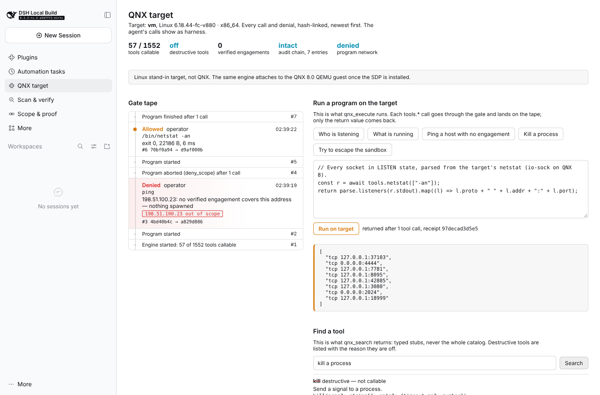

# dsh-qnx

The DeepSeek Harness, built for a **QNX 8.0** target (QEMU x86_64, SDP 8.0 / `qcc`). It adds three sidebar entries and two agent tools to the harness. Behind them sit a scope gate, an on-target runner and a hash-chained audit log, so the agent can reach only what it is allowed to reach and every action leaves a receipt.

> **Status:** everything runs and is tested against a **Linux stand-in target** standing where the QEMU guest will be. The QNX build itself (SDP install, image, boot) is Phase 0 and has not run yet. The pages say "stand-in target, not QNX" until it has.



## What it adds

Three entries in the left sidebar, each opening its own page in the main column:

| Entry | Page |
|:--|:--|
| QNX target | The target's identity and gate state, the live **gate tape** (every call and denial, hash-linked), a program runner and tool search. These are the same two operations the agent's tools perform. |
| Scan & verify | Five native checks against the image manifest, each finding linked to its receipt. A claims board where Agent Smith's seat reproduces every finding and returns CONFIRMED, REFUTED or UNPROVEN, and a signed verified report. |
| Scope & proof | What the agent may reach (the target itself plus operator-signed engagements), the sandbox posture, chain verification and the signed seal. |

Two tools for the agent, in Code Mode:

- `qnx_search` finds tools on the target by intent and returns typed stubs.
- `qnx_execute` runs a short program that calls those stubs. Only its return value comes back.

Every `tools.*` call a program makes passes the gate in this order: the tool exists on the target, it isn't destructive (off by default), its arguments pass the rules, it touches no protected path, and every target in its argv is in scope. Only then does it reach the runner on the target. A denial spawns nothing and sends no packet. A system-prompt section tells the model all of this.

The page and the model share one engine and one audit chain. A program run from the page is recorded under the `operator` seat, and one the agent runs is recorded under `harness`.

## Configuration

Set on the bundle's row in the profile's `cordis.patch.yml`:

| Field | Default | Meaning |
|:--|:--|:--|
| `target` | `standin` | `standin` builds and starts a Linux stand-in target on this machine (Linux only). `qnx` attaches to the QNX 8.0 QEMU guest's runner, forwarded to `127.0.0.1:7781` |
| `engineConfig` | `''` | Engine config file; empty means `engine/standin/config.json` or `engine/qnx/config.json` by target |
| `tools` | `true` | Register `qnx_search` and `qnx_execute` |
| `guide` | `true` | Add the QNX section to the system prompt |
| `maxBodyBytes` | `262144` | Largest accepted panel API request body |

The superagent profile sets `target: qnx`, because the stand-in needs Linux. Until Phase 0 writes `engine/qnx/config.json`, the pages say so and name the script to run.

## Install

On a machine whose `start-super-harness.ps1` first-run setup has already run:

```sh
cd src/dsh-qnx && pnpm install && pnpm run build
cd ../deepseek-harness && pnpm dsh plugin --profile superagent add "link:<full path to>/src/dsh-qnx"
```

A fresh checkout's first-run setup does both. The superagent profile's patch already carries the `dsh-qnx` row.

To try it on Linux against the stand-in, with its own profile:

```sh
cd src/deepseek-harness
pnpm dsh qnx --from-default-profile web --dump-config > /dev/null
pnpm dsh plugin --profile qnx add "link:$(realpath ../dsh-qnx)"
pnpm dsh qnx                     # open the printed URL; the QNX entries are in the sidebar
sh ../dsh-qnx/engine/scripts/plant-standin-faults.sh   # give the checks something real to find
```

## Panel API

The pages read and act through `/qnx/api/*`:

- reads: `state`, `audit`, `audit/stream` (NDJSON), `search`, `board`, `seal`, `health`
- actions: `execute`, `checks`, `board/post`, `board/plant`, `board/reset`, `smith`, `report/verified`

The route is owner-only (`auth: 'required'`) and refuses a request whose `Host` or `Origin` does not name this page. The operation set is closed, with no general command route. `execute` goes through the same gate and limits as the agent's tool.

Agent Smith runs as its own process with its own seat token. It reaches the engine through a loopback MCP listener (`127.0.0.1:8095/mcp`), which outside MCP clients can also use with a seat token.

## Layout

```
src/index.ts          Host half: engine lifecycle, tools, guide, panel API
src/host/             engine.ts (boot, stand-in runner), tools.ts, http.ts
src/client/           sidebar entries and pages (harness theme tokens; en + zh)
engine/               the QNX agent engine (CommonJS, zero dependencies):
  node-runtime/       qnx-runner.c (on-target, POSIX C: cc or qcc) and inventory-qnx.sh (POSIX sh + awk)
  gateway/            gate, scope (incl. Qnet), audit chain, sandbox, checks runner, board, reports, MCP listener, cli.js
  checks/             five native checks; loop/smith.js, the verifier seat
  image/, scripts/    [SDP] image build, QEMU run, phase0.sh; stand-in baseline, fault planting, prove.js
  test/, docs/        19 engine tests; architecture, demo script, receipts, submission checklist
test/bundle.test.mjs  applies the built Host half and calls the registered tools
```

## Tests

```sh
pnpm run check                     # everything below: typecheck, build, 19 engine tests, 3 bundle tests
pnpm test                          # 19 engine tests: unit + hermetic end-to-end + fake-QNX format fixtures
pnpm run test:bundle               # build, then 3 bundle tests: registration, search, execute through the gate
pnpm run prove                     # done-test receipts (stand-in) -> engine/docs/receipts/
```

## Limitations

- The stand-in target needs Linux (`make`, `sh`, and `unshare` for the sandbox's network namespace). On Windows, use `target: qnx`.
- Phase 0 (`engine/scripts/phase0.sh`) needs an Ubuntu host, because QNX documents QEMU images for Ubuntu. On Windows, use WSL2 Ubuntu or a Linux machine. Once it has run, the harness on the same machine attaches with `target: qnx`. On Windows, run Phase 0 in WSL2 against the Windows checkout (`/mnt/c/...`), so it writes `engine/qnx/config.json` where the Windows harness reads it. WSL2 forwards `localhost`, so the harness reaches the runner on `127.0.0.1:7781`.
- The agent tools need the harness's model (a DeepSeek key or sign-in). The pages work without one.
